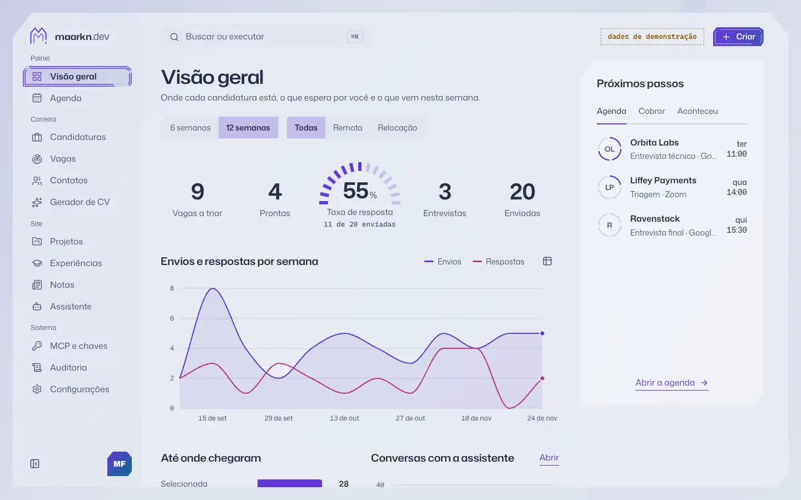
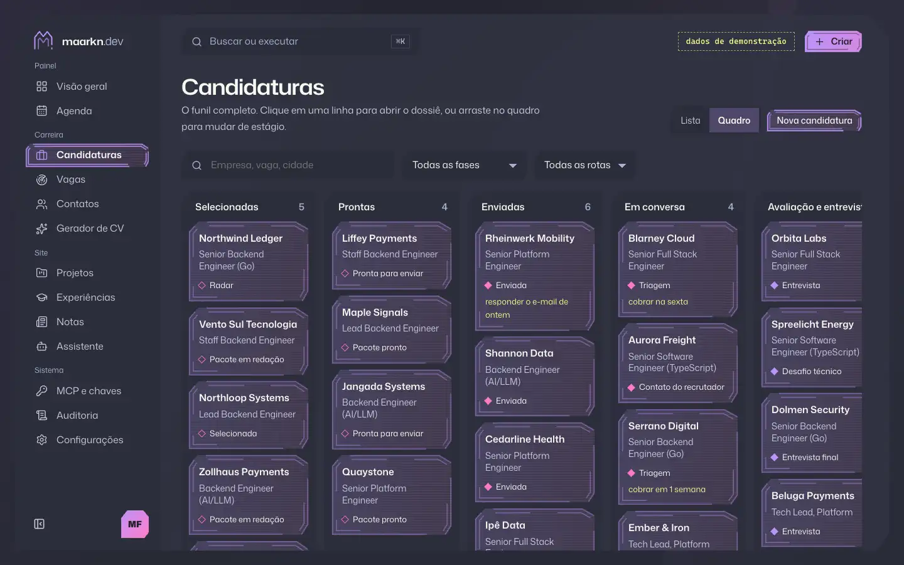
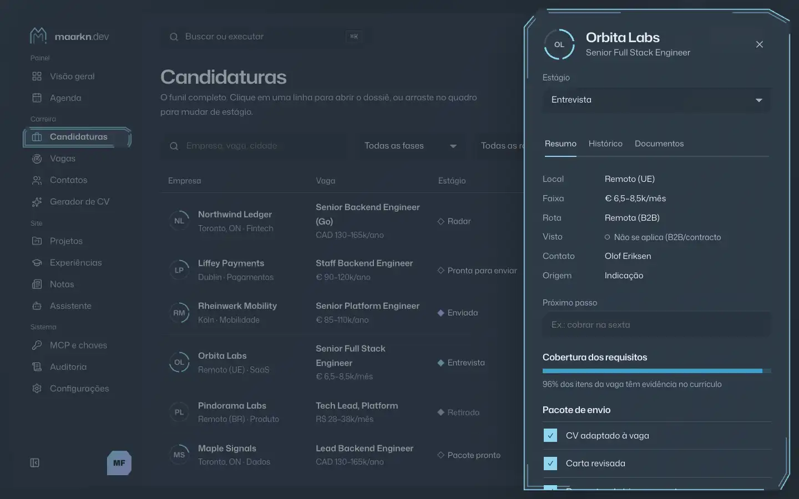
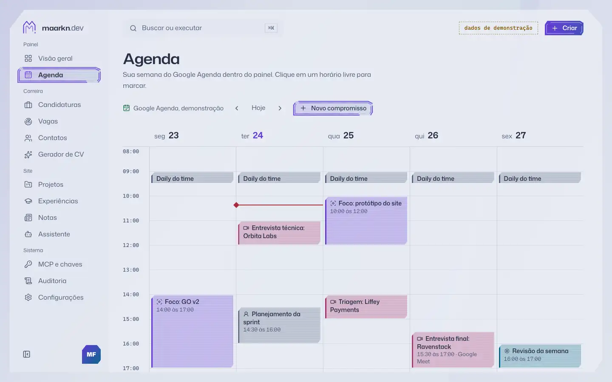
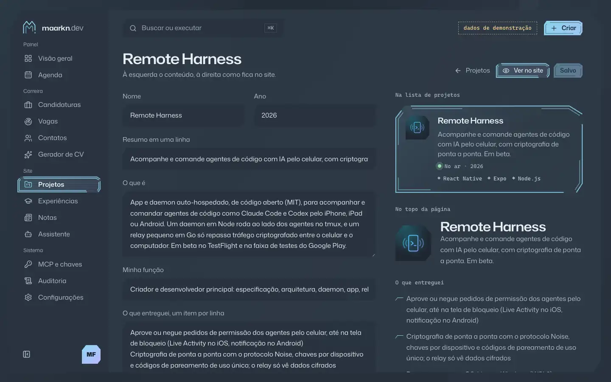

# Telas do backoffice

Mesma linguagem do site, com volume mais baixo: uma folha única sobre planos diagonais. Rotas em inglês, sem prefixo de idioma; interface em PT e EN, com troca no menu da conta e início pelo idioma do site. Três temas.

## Navegação

| Grupo | Itens |
|---|---|
| Painel | Visão geral, Agenda |
| Carreira | Candidaturas, Vagas, Contatos, Gerador de CV |
| Site | Projetos, Experiências (em breve), Notas, Assistente |
| Sistema | MCP e chaves, Auditoria, Configurações |

Menu expandido a partir de 1.360 px e recolhível, com o nome em dica; no celular, barra inferior com quatro atalhos e "Mais". No topo: busca (`⌘K`) por página, candidatura ou ação, e "Criar" (candidatura, compromisso, projeto, currículo). Menu da conta: tema, idioma, configurações, ver o site, sair.

## Visão geral

- Filtros de período e rota valem para tudo abaixo.
- **Números sem caixa:** vagas a triar, prontas, enviadas, entrevistas da semana, e no centro o medidor da taxa de resposta. Sem base para calcular, mostra "—", nunca 0%.
- **Envios e respostas por semana:** linhas, com cruz de leitura e tabela.
- **Até onde chegaram:** barras por estágio alcançado, com a conversão da etapa anterior.
- **Conversas com a assistente:** colunas por dia.
- **Precisa de você hoje** e painel lateral com **Agenda**, **Cobrar** e **Aconteceu**. O anel do avatar tem um traço por fase vencida.

## Candidaturas

- **Lista:** empresa, vaga, estágio, visto, enviada, atualizada; busca, fase e rota; ordenação e paginação.
- **Quadro:** seis colunas; arrastar ou setas do teclado mudam o estágio.
- **Dossiê:** painel lateral com o resumo e página completa com tudo. Abas: resumo, vaga e empresa, entrevistas, histórico, documentos, requisitos, triagem, observações de honestidade, checklist.

O dossiê mostra: descrição da vaga; sobre a empresa (vale para todas as candidaturas dela); contexto do projeto; entrevistas previstas e marcadas; documento enviado (currículo e carta em PDF); motivo de encerramento.

## Agenda

Semana de segunda a sexta, com os calendários escolhidos. Compromissos do calendário "Entrevistas" podem ser criados, movidos e removidos; os demais são só leitura. Clicar em horário livre marca. Sem conexão com o Google, a tela explica como conectar e as entrevistas continuam visíveis.

## Projetos

- **Lista** com o controle "Caso na home" (três, com aviso ao tentar o quarto).
- **Editor** em PT e EN com prévia ao vivo (card, topo e entregas), galeria e texto do caso.
- **Rascunhos:** projeto com rascunho aberto mostra a comparação com o que está no ar, e os botões publicar e descartar.

## Demais telas

- **Vagas:** nota, motivo, visto; descartar ou transformar em candidatura.
- **Contatos:** recrutadores e referências.
- **Gerador de CV:** vaga de um lado, texto do outro.
- **MCP e chaves:** chaves com escopos, criação com exibição única, e a lista de skills do plugin.
- **Auditoria:** uma linha por chamada MCP.
- **Assistente:** perguntas e respostas, com "marcar como lacuna".
- **Configurações:** disponibilidade e destinos do site, aparência, idioma, fuso, integrações, conta.
- **Login:** janela única; erro genérico; o limite por IP continua valendo.

## Ícones de tecnologia

Monocromáticos, na cor do texto, ao lado do nome. Quando não há logo, fica só o nome. Nunca o ícone sozinho.
