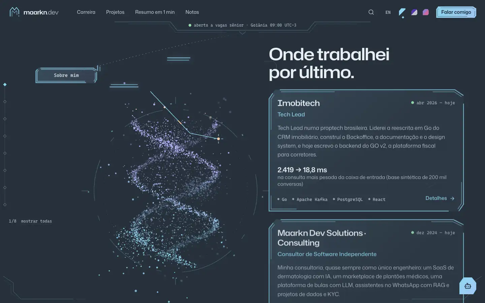
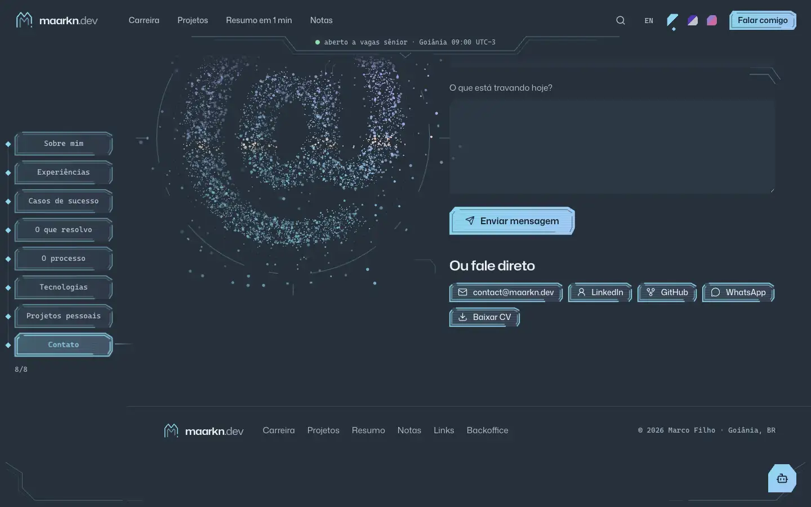

# Projeção, tags e trilho

## Projeção

Um objeto de partículas que viaja com a rolagem e muda de forma a cada seção. A posição vem do layout: cada seção declara onde a projeção e a tag ficam, e a projeção persegue esses retângulos.

| Seção | Forma | Por quê |
|---|---|---|
| Abertura | Lente aberta | A origem do feixe |
| Sobre mim | Globo, com Goiânia marcada | Passar por um país traça a rota até ele |
| Experiências | Hélice com três nós | As três últimas casas |
| Casos de sucesso | Três telas empilhadas | Os três casos |
| O que resolvo | Caos que vira grade conforme a rolagem | Problema bagunçado que se organiza |
| O processo | Fita em ∞ | O ciclo com o cliente |
| Tecnologias | Núcleo com seis órbitas | Os seis grupos |
| Projetos pessoais | Nó | A bancada |
| Contato | @ | |

- As partículas se afastam do ponteiro, e rolagem rápida as agita.
- Uma faixa de luz varre o objeto de cima a baixo.
- Atrás de texto, as partículas se apagam (zona de leitura).
- No tema claro a mistura é normal; nunca aditiva.

### Desempenho

[ADR 0001](../adr/0001-projecao-em-webgl-puro.md). Motor em WebGL puro, carregado depois do texto visível, no máximo 6.800 pontos no desktop e 3.200 no celular, pausado com a aba oculta. O JavaScript próprio da home fica abaixo de 60 kB comprimidos, com o motor incluído.

**Alternativa estática:** com movimento reduzido, economia de dados ou sem WebGL, a seção mostra uma imagem fixa da forma. Tags, linha-guia e trilho continuam funcionando.

**Ponto de decisão:** comparar lado a lado com o protótipo, nos três temas, no desktop e em um celular intermediário. Se não igualar, volta-se para Three.js e o orçamento é revisto na mesma change.

## Tags

Cada seção tem uma tag, alternando direita e esquerda. A sequência:

1. A linha-guia sai da projeção: trecho raso, cotovelo, subida a 45° até a tag.
2. A moldura se monta traço a traço e o texto decodifica.
3. Ao passar para a próxima seção, a linha se apaga e a tag voa em arco até o trilho.
4. No trilho, ela encolhe, pisca e fica.

## Trilho

Menu vertical à esquerda, a partir de 1.180 px; abaixo disso, um botão na base da tela que abre a lista de seções e de páginas.

- **Não desfaz.** Rolar para cima não devolve a tag à seção. Vale durante a sessão do navegador e nas páginas internas.
- **Pular seções** (por link ou rolagem rápida) materializa no trilho as que ficaram para trás.
- **"Mostrar todas"** revela o trilho inteiro.
- **Acessível desde o início.** As oito seções estão no HTML e são alcançáveis por teclado e leitor de tela; "descobrir" só muda a aparência. Focar uma tag não descoberta a revela.
- A seção atual fica marcada.

