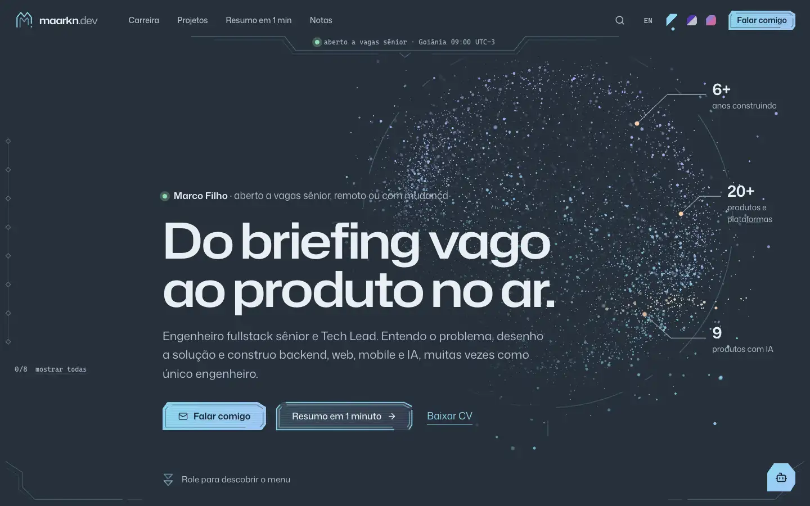
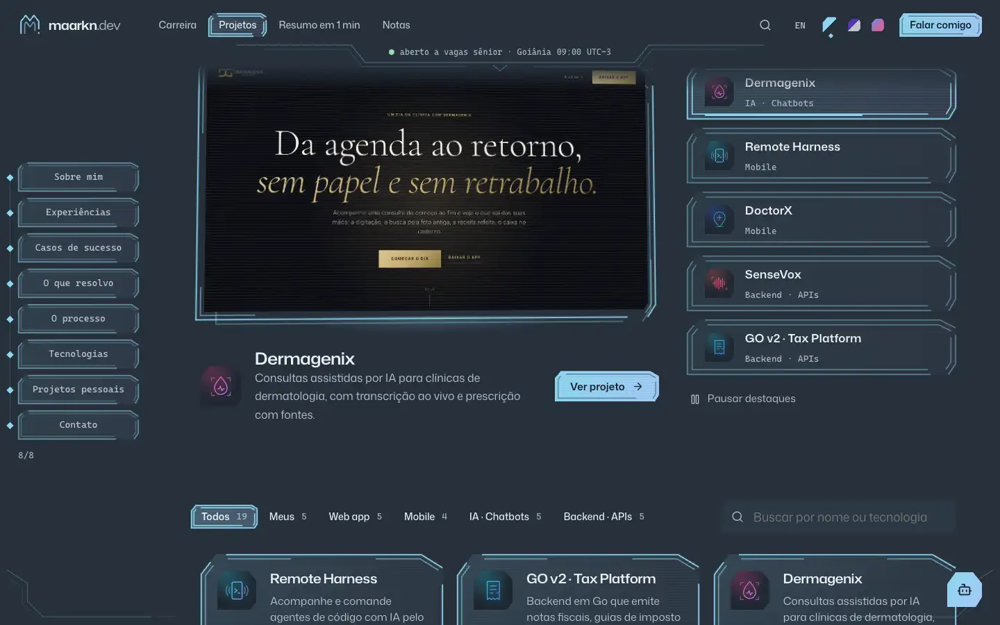
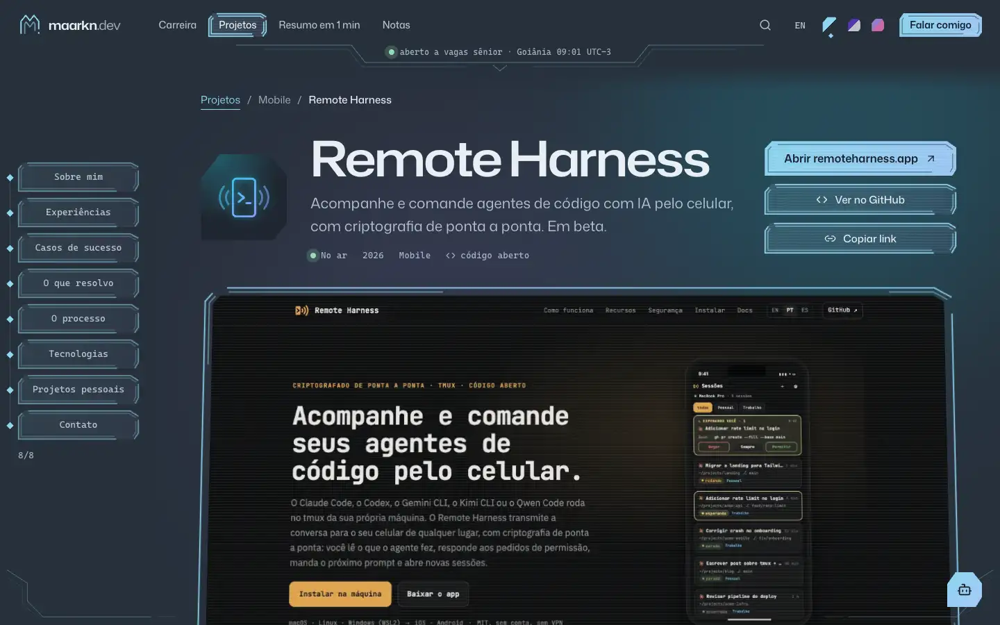
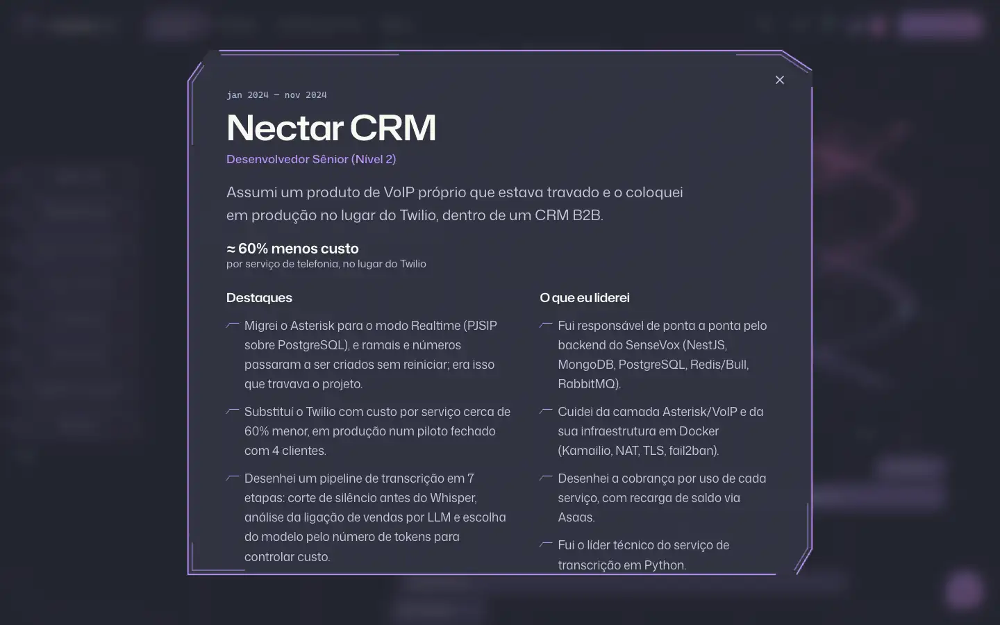
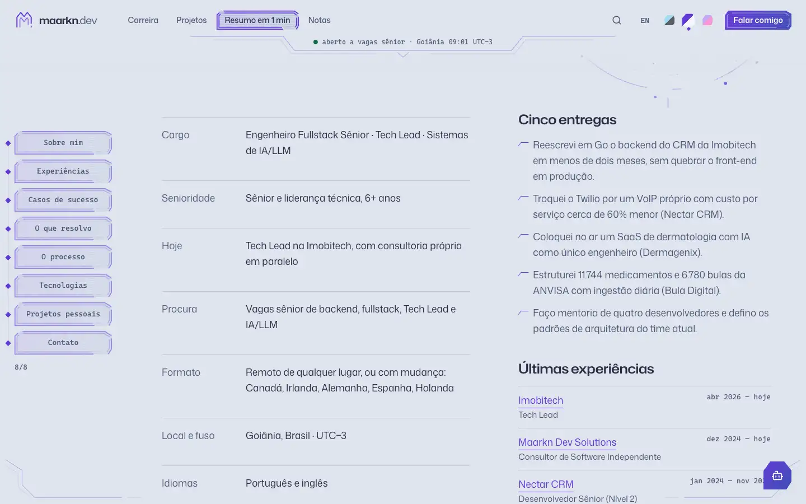
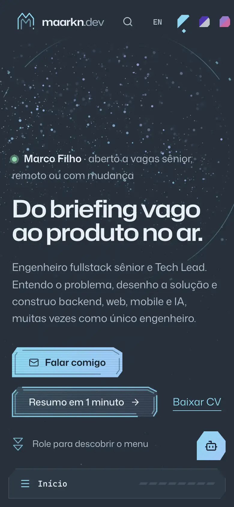
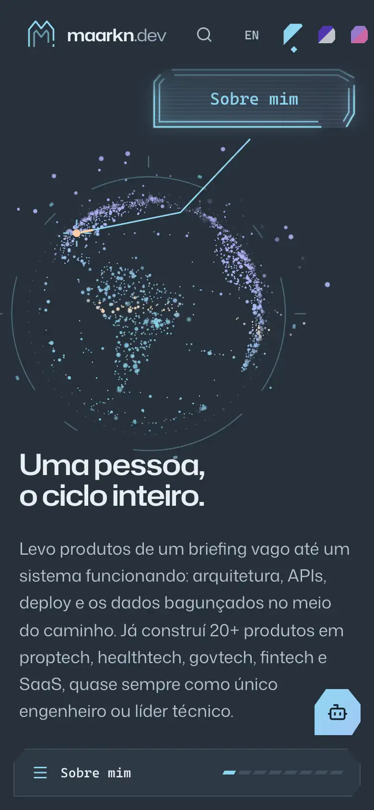
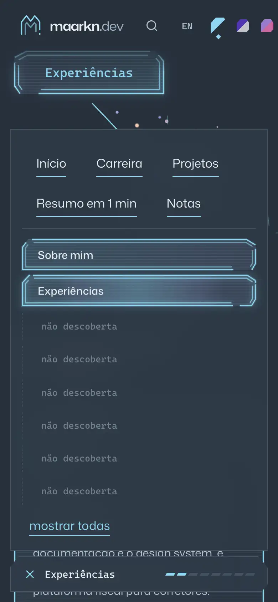

# Telas do site

Todas as rotas têm prefixo de idioma (`/en`, `/pt-BR`). Endereços existentes não mudam.

| Rota | Tela | Situação |
|---|---|---|
| `/[lang]` | Home de oito seções | nova |
| `/[lang]/projects` e `/projects/[slug]` | Projetos | redesenhada |
| `/[lang]/career` e `/career/[slug]` | Carreira | redesenhada |
| `/[lang]/summary` | Resumo em 1 minuto | nova |
| `/[lang]/blog` e `/blog/[slug]` | Notas | redesenhada |
| `/[lang]/links` | Links | redesenhada |
| `/[lang]/terminal` | Versão CLI | movida da home |
| `/[lang]/chat` | Abre a home com a assistente aberta | redireciona |

Links antigos: `/[lang]?cmd=…` leva a `/[lang]/terminal?cmd=…`. `/#contact`, `/#projects` e `/#about` levam às seções equivalentes. A Versão CLI é indexável, mas fica fora do sitemap.

## Em todas as telas

- **Topo:** marca, Carreira, Projetos, Resumo em 1 min, Notas, busca, idioma, tema, botão da Versão CLI (`>_`) e "Falar comigo". Um entalhe HUD mostra disponibilidade e hora de Goiânia a partir de 1.280 px.
- **Busca (`⌘K` / `Ctrl+K`):** seções, páginas, projetos, experiências, temas, idioma, CV e Versão CLI. Busca sem acento e por tecnologia. Uma frase que não casa com nada pode ser enviada à assistente.
- **Assistente:** botão flutuante que abre um painel lateral, com perguntas sugeridas. Usa a assistente e os limites que já existem.
- **Trilho:** [projecao.md](./projecao.md).
- **Rodapé:** páginas, Versão CLI e contato.

## Home

Conteúdo renderizado no servidor e legível sem JavaScript.

| Seção | Conteúdo | Interação |
|---|---|---|
| Abertura | Nome, disponibilidade, título, apoio; três números ligados à projeção por linhas-guia | Falar comigo, Resumo em 1 minuto, Baixar CV |
| Sobre mim | Três parágrafos da bio, base, idiomas, setores | Destinos: passar por um país traça a rota no globo |
| Experiências | As três mais recentes, com o número que resume cada uma | Abre o modal; link para a carreira completa |
| Casos de sucesso | Os três casos: tela, problema, trabalho, resultado | Abre o projeto |
| O que resolvo | Seis dores de cliente | Abre a solução e o projeto que a comprova |
| O processo | Cinco etapas em fluxograma, com as voltas "ajusta até fazer sentido" e "próximo ciclo" | Cada etapa mostra "sua parte" e "você recebe"; avança sozinha até alguém interagir |
| Tecnologias | Seis grupos, anos de uso, ícone | Escolher uma mostra em que projetos e empresas entrou |
| Projetos pessoais | Um em destaque e os demais | Abre o projeto, o site e o código |
| Contato | Formulário e canais diretos | Envia pelo formulário que já existe |

Tecnologia não tem barra de proficiência: mostra anos e onde foi usada.

### Textos novos

Entram como estão e são revisados por Marco no PR. Números e fatos vêm dos dicionários.

**Abertura:** "Do briefing vago ao produto no ar." / "From a rough brief to a live product."

**O que resolvo:** "Você conta a dor. Eu devolvo funcionando." / "You bring the pain. I return it working."

| Dor | Solução | Projeto |
|---|---|---|
| Tenho a ideia, mas não tenho time técnico. | Assumo da arquitetura ao deploy: desenho o produto, construo web, mobile e backend, e publico nas lojas. O Dermagenix nasceu assim, com uma pessoa só na engenharia. | Dermagenix |
| Pago caro por uma ferramenta de terceiros. | Construo o substituto próprio e coloco em produção. No Nectar CRM, o SenseVox entrou no lugar do Twilio com custo por serviço cerca de 60% menor. | SenseVox |
| Quem fez o sistema saiu, e ninguém mexe nele. | Assumo sem passagem de bastão: protejo a produção, documento, estabilizo e só então evoluo. Foi o que fiz no app de visitas de campo do agro. | Agritech |
| Meu atendimento no WhatsApp não dá conta. | Assistentes que respondem com o conteúdo da sua empresa, por texto e voz, e avisam quando uma pessoa precisa entrar. | Miami Real Estate |
| A informação existe, mas está espalhada e bagunçada. | Coleto, estruturo e deixo pesquisável. O Bula Digital estruturou 11.744 medicamentos e 6.780 bulas da ANVISA e reescreve tudo em linguagem simples. | Bula Digital |
| O sistema ficou lento e difícil de mudar. | Reescrevo a parte certa sem parar o que funciona. No CRM da Imobitech, uma consulta crítica caiu de 2.419 ms para 18,8 ms numa base sintética de 200 mil conversas. | GO v2 |

**O processo:** "Da conversa à entrega, com você dentro." / "From conversation to delivery, with you in it."

| Etapa | O que acontece | Sua parte | Você recebe |
|---|---|---|---|
| Escuto a dor | Conversa direta com quem sente o problema. Sem intermediário e sem jargão: quero entender o que trava o seu dia, não só a funcionalidade pedida. | Conta como é hoje e o que já tentou. | O problema escrito em uma página, para você confirmar. |
| Proponho caminhos | Trago opções com prós, contras e esforço. Recomendo uma e digo o que eu não faria agora. | Escolhe o caminho e o que fica de fora. | Escopo fechado e a arquitetura mais simples que resolve. |
| Prototipo | Antes de construir, você clica. O protótipo mostra o fluxo inteiro, e mudar de ideia aqui custa horas, não semanas. | Usa, aponta o que incomoda e aprova. | Um protótipo navegável da sua solução. |
| Desenvolvo | Entregas curtas, com algo funcionando para ver a cada ciclo. Web, mobile, backend e IA com a mesma pessoa, então nada se perde entre times. | Acompanha e prioriza o próximo ciclo. | Versões reais, testadas, a cada ciclo. |
| Entrego no ar | Infraestrutura, deploy, lojas de apps e documentação. Entrego rodando e explico como manter. | Usa com seus clientes e me conta o que viu. | Produto no ar, código e documentação seus. |

**Casos de sucesso:** Dermagenix (no ar), DoctorX (beta fechado, e o texto diz isso) e SenseVox (produção em piloto com 4 clientes).

## Projetos

- **Lista:** contagem por situação, destaques que passam sozinhos (com pausa), categorias com quantidade (inclui "Meus") e busca por nome ou tecnologia. Vazio oferece "Limpar filtros". Filtro e busca ficam na URL.
- **Detalhe:** caminho de volta, ícone, nome, resumo, situação, ano, categoria e código aberto ou privado; abrir, ver código, copiar link (ou "Pedir uma demonstração" quando não há link); tela ou projeção do ícone; o que é, qual foi a minha função, o que entreguei, galeria quando houver, perguntas rápidas; ao lado, ficha técnica, links e contato; projetos parecidos e o próximo.
- **Perguntas rápidas** saem dos dados: está no ar, função, código, tecnologias.
- **Sem imagem:** projeção do ícone do projeto, em camadas.

## Carreira

Linha do tempo em barras (2020 até hoje, com sobreposição) e a lista completa. Clicar abre o modal; abrir o endereço direto carrega a página inteira. No modal, setas trocam de experiência e `Esc` fecha.

## Resumo em 1 minuto

Para quem tria currículos: cargo, senioridade, situação atual, o que procura, formato, fuso, idiomas, stack, IA; cinco entregas, últimas experiências e os três casos. Copiar o resumo em texto, baixar o CV, e-mail.

## Celular

Abaixo de 980 px as seções viram uma coluna, com a projeção acima do texto. O trilho vira o botão da base, que lista páginas e seções.

| | | |
|---|---|---|
|  |  |  |
